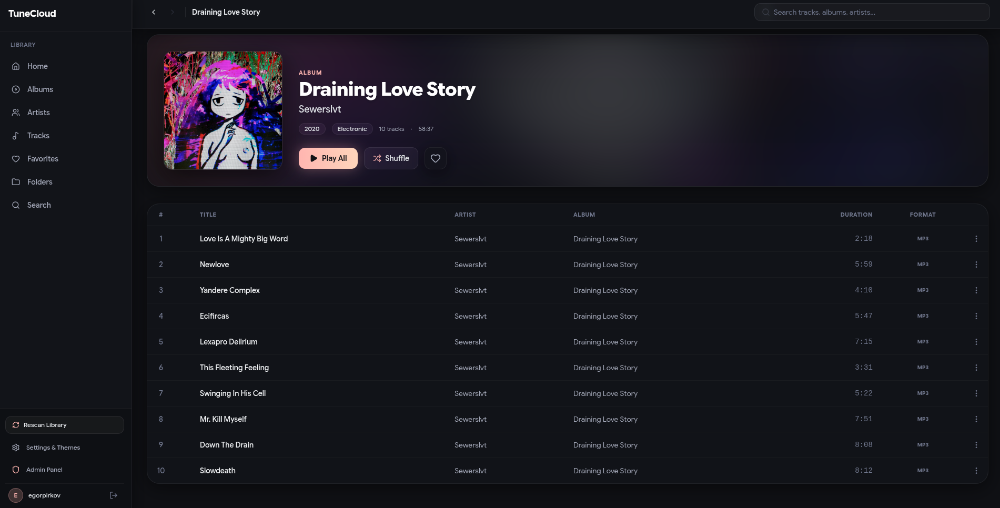
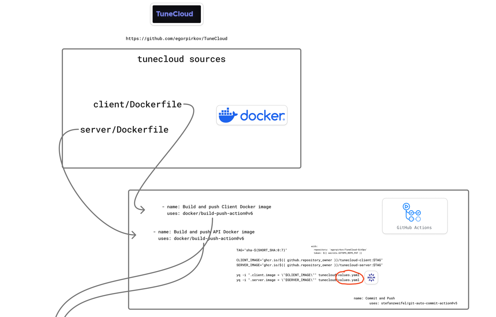
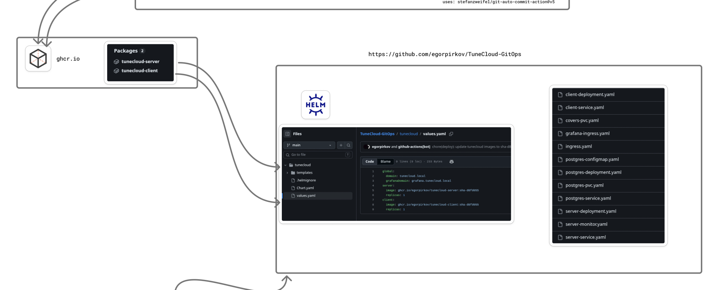
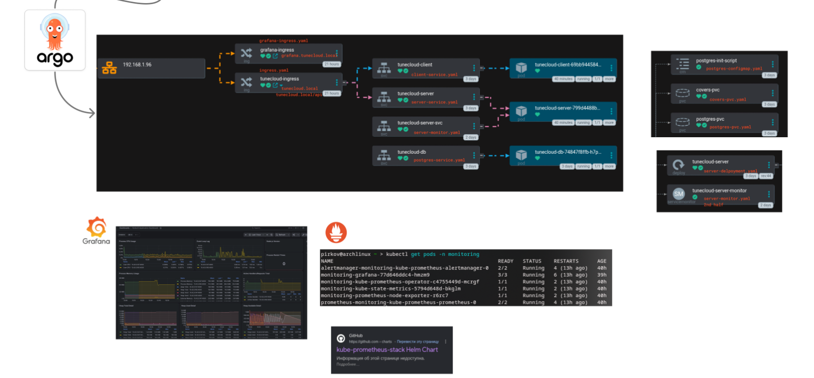
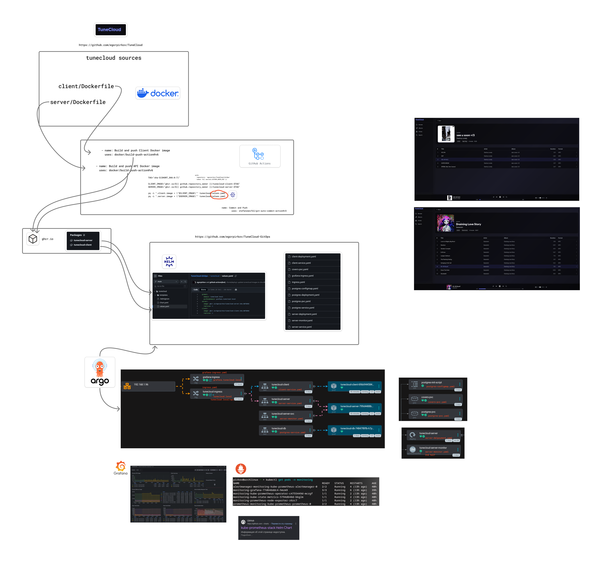

# TuneCloud - Cloud-Native Music Platform ☁️🎵

<div align="center">
    <a href="https://www.docker.com/" target="_blank" rel="noreferrer">
        
    </a>
    <a href="https://www.nginx.com/" target="_blank" rel="noreferrer">
        
    </a>
    <a href="https://www.postgresql.org/" target="_blank" rel="noreferrer">
        
    </a>
    <a href="https://kubernetes.io/" target="_blank" rel="noreferrer">
        
    </a>
    <a href="https://helm.sh/" target="_blank" rel="noreferrer">
        
    </a>
    <a href="https://argo-cd.readthedocs.io/" target="_blank" rel="noreferrer">
        
    </a>
    <a href="https://prometheus.io/" target="_blank" rel="noreferrer">
        
    </a>
    <a href="https://grafana.com/" target="_blank" rel="noreferrer">
        
    </a>
</div>

---

**TuneCloud** is a self-hosted music server and streaming platform built with Node.js, PostgreSQL, and React, designed from the ground up for automated cloud-native deployment. It combines a modern **Spotify-inspired glassmorphic Web UI** with **full Subsonic / OpenSubsonic API compatibility**, backed by a production-ready DevOps delivery lifecycle.

---

## 📸 Interface



---

## 🎯 Project Goals (DevOps Showcase)

The project was built to demonstrate practical, production-grade DevOps workflows around a real-world, high-traffic application:

* **Infrastructure as Code & GitOps**: Clear separation of application code and deployment configuration via a dedicated GitOps repository.
* **Automated CI/CD Pipeline**: Multi-stage Docker builds using GitHub Actions, pushing versioned short-SHA tagged images to **GitHub Container Registry (GHCR)**, with automated GitOps updates via `yq`.
* **GitOps Continuous Delivery**: **ArgoCD** continuously monitors the GitOps repository and synchronizes desired state to a **k3s Kubernetes** cluster with rolling zero-downtime updates.
* **Kubernetes Orchestration**: Production-configured workloads with Helm, ConfigMaps, Secrets, Ingress routing, Persistent Volume Claims (PVCs), and health probes.
* **Full-Stack Observability**: Native metrics scraped from `fastify-metrics` and `postgres-exporter` by Prometheus ServiceMonitors, visualized with custom Grafana dashboards.
* **Security & Network Hardening**: Rate limiting (`@fastify/rate-limit`), security headers (`@fastify/helmet`), directory traversal protection, and token-authenticated audio streaming.

---

## ✨ Application Features

### 🎨 Modern Web Experience
* **Spotify-Inspired Glassmorphism**: Clean dark aesthetic with glass panels and customizable accent palettes (Peach, Emerald, Amber, Violet, Cyan).
* **Live Search**: Instant keyboard-driven global search dropdown with direct navigation to tracks, artists, and albums.
* **Synchronized Lyrics**: Built-in karaoke synchronized lyrics display supporting embedded tags, local `.lrc` / `.txt` files, and LRCLIB integration.
* **Interactive Player & Queue**: Volume scroll wheel, draggable playback scrubber, persistent queue drawer, and cover art lightbox.
* **Dual-Mode Library Synchronization**:
  * **Incremental Rescan**: Ultra-fast filesystem diffing based on `mtime`, detecting newly added/removed files and auto-healing unlinked tracks without re-reading unchanged files.
  * **Full Rescan**: Deep tag re-parsing from disk, complete cover art re-extraction, and orphan metadata cleanup.

### 📱 OpenSubsonic & Subsonic API (v1.16.1)
Connect seamlessly with all popular Subsonic ecosystem clients (**Symfonium**, **Feishin**, **DSub**, **Tempo**, **Substreamer**):
* **60+ Subsonic API Endpoints**: Full parity covering streaming, transcoding, scrobbling, playlists, star ratings, and search.
* **Real Filesystem & ID3 Browsing**: Browse by artist/album ID3 tags or explore real disk folder hierarchies (`getIndexes` & `getMusicDirectory`).
* **OpenSubsonic Extensions**: `songLyrics`, `playQueue`, `topSongsByArtistId`, `formPost`, `transcodeOffset`, and `playlistUpload`.
* **Standard Authentication**: Token authentication (`u` + `t` + `s` MD5 salt) and clear/hex token support.

---

## 🏗️ Architecture & Pipeline Visualization









---

## 🏗️ Cloud-Native Architecture & Kubernetes

The application is deployed on a **Kubernetes (k3s)** cluster using a custom **Helm Chart** stored in a separate GitOps repository.

### Kubernetes Resources

* **Compute**

  * `tunecloud-server`: Node.js backend API (Fastify)
  * `tunecloud-client`: Nginx serving the React SPA
  * `tunecloud-db`: PostgreSQL 16 database
  * `postgres-exporter`: PostgreSQL metrics exporter

* **Networking & Ingress**

  * ClusterIP and NodePort Services for internal and external communication
  * `ingress.yaml`: routes `tunecloud.local` to the client and `tunecloud.local/api` to the server
  * `grafana-ingress.yaml`: routes `grafana.tunecloud.local` to Grafana

* **Storage**

  * `postgres-pvc`: persistent PostgreSQL data
  * `covers-pvc`: persistent storage for album covers

* **Configuration**

  * `postgres-configmap`: SQL initialization scripts for database schema creation
  * Kubernetes Secrets: `ghcr-secret`, `spotify-secret`, and `jwt-secret`

Secrets used by the application are created manually during deployment and referenced by the workloads.

---

## 🔄 CI/CD & GitOps Pipeline

The delivery pipeline is automated using **GitHub Actions**, **Helm**, and **ArgoCD**, following a GitOps workflow.

### 1. Continuous Integration

* A push to the `main` branch triggers GitHub Actions.
* Multi-stage Docker builds are executed for the client and server.
* Images are tagged with the short Git commit SHA.
* Images are pushed to **GitHub Container Registry (GHCR)**.

### 2. GitOps Update

* The CI pipeline uses `yq` to update image tags in `values.yaml` in the separate GitOps repository.
* The updated configuration is committed and pushed automatically.

### 3. ArgoCD Deployment

* **ArgoCD** detects changes in the GitOps repository.
* ArgoCD synchronizes the desired state with the k3s cluster.
* Kubernetes performs a rolling update of the workloads, allowing new Pods to replace old ones without application downtime.

---

## 📊 Monitoring & Observability

Monitoring is implemented using the **kube-prometheus-stack**.

* **ServiceMonitors**

  * `server-monitor.yaml`: scrapes custom application metrics from `/metrics`, exposed by `fastify-metrics`
  * `postgres-exporter-monitor.yaml`: scrapes PostgreSQL health and performance metrics

* **Prometheus**

  * Collects and stores metrics from the application and database.

* **Grafana**

  * Provides custom dashboards for visualizing application and infrastructure metrics.
  * Accessible through `grafana.tunecloud.local`.

---

## 💻 Tech Stack

| Domain                             | Technologies                                      |
| ---------------------------------- | ------------------------------------------------- |
| **Infrastructure & Orchestration** | Kubernetes (k3s), Docker, Helm                    |
| **CI/CD & GitOps**                 | GitHub Actions, ArgoCD, Git                       |
| **Monitoring & Metrics**           | Prometheus, Grafana, Postgres Exporter            |
| **Protocols & Integrations**       | OpenSubsonic / Subsonic v1.16.1, Spotify API, LRCLIB |
| **Backend**                        | Node.js 22, Fastify, PostgreSQL 16                |
| **Frontend**                       | React 18, Vite, Tailwind CSS 3, Lucide, Nginx     |

---

## 🚀 Quick Start

### Docker Compose

```bash
git clone https://github.com/egorpirkov/TuneCloud.git tunecloud
cd tunecloud

# Setup environment variables
cp server/.env.example server/.env

# Start the entire stack
docker compose up -d --build
```

### Helm

```bash
helm install tunecloud ./tunecloud -n tunecloud --create-namespace
kubectl get pods -n tunecloud
```

## 📜 License

GPL v3.0
