# TuneCloud

A self-hosted music server with a React web player, a Subsonic-compatible API, and a Docker-to-Kubernetes delivery pipeline.

[Production instance](https://tune.realgeek.ru/) · [Quickstart](#quickstart) · [Development](#development) · [GitOps repository](https://github.com/skippingclass/TuneCloud-GitOps)

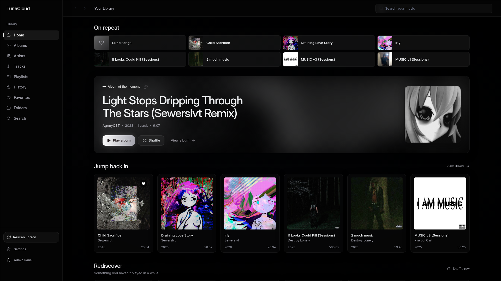

## Features

- **Your music, on your server.** Scan local folders, browse albums and artists, search the collection, and manage playlists and favorites.
- **A web player built for listening.** A floating player, mobile now-playing screen, editable playback queue, sleep timer, cover viewer, and responsive layouts. Playback position and queue are restored on this browser, paused, separately for each account. Midnight is the default theme, with additional color themes and subtle glass surfaces.
- **Line-synchronized lyrics.** Highlighting, automatic scrolling, and click-to-seek from local files, embedded tags, [lrc.red](https://lrc.red), and [LRCLIB](https://lrclib.net). Word timestamps are reduced to line timing.
- **Subsonic clients.** Native audio streaming with HTTP range requests, search, playlists, favorites, ratings, scrobbling, and saved queues. Streaming serves the original audio; server-side transcoding is not implemented.
- **Incremental library scans.** Re-read changed files or run a full metadata scan. Missing files retain their IDs and playlist, favorite, and history references.
- **Listening history.** A personal timeline with repeated plays, dates, and pagination. Select multiple tracks to add them to favorites, a playlist, or the queue.
- **Multiple users.** Administrator-managed accounts, personal listening history, session revocation, and optional tag editing for MP3, FLAC, Ogg, Opus, M4A, WAV, WMA, and AAC.

## Last.fm

The web player and installed PWA can scrobble to a personal Last.fm account. Subsonic clients keep their existing behavior and can manage their own Last.fm connection.

The server owner registers a [Last.fm API application](https://www.last.fm/api/account/create), sets its callback to `PUBLIC_URL/settings`, and configures `PUBLIC_URL`, `LASTFM_API_KEY`, `LASTFM_API_SECRET`, and `LASTFM_ENCRYPTION_KEY` (a stable random secret of at least 32 characters). HTTPS is required except on localhost. Docker Compose passes these variables to the server; Kubernetes installations must add them to their server configuration and Secrets in the GitOps repository. Back up the encryption key with the database.

Each user then opens **Settings → Last.fm → Connect Last.fm** and grants access on Last.fm. No Last.fm password or API key is entered in TuneCloud. Sessions are encrypted on the server. Changing the encryption key requires reconnecting accounts; rotating `JWT_SECRET` does not.

New connections enable scrobbling and first-artist selection, with Now Playing disabled. The default threshold is half the track or four minutes, excluding tracks of 30 seconds or less. Users can raise these thresholds, toggle Now Playing, select the first credited artist, correct metadata for individual tracks, and exclude tracks or artists. Corrections affect future Last.fm events only. Local listening history keeps its own threshold. Existing history is never uploaded automatically.

Accepted scrobbles are stored in PostgreSQL and retried after temporary failures, including server restarts. A per-user browser buffer holds up to 250 unacknowledged events while the server is unavailable; installed-app offline audio playback is still unsupported. Settings show delivery results and allow retrying pending errors. Disabling scrobbling pauses the queue; disconnecting or reconnecting clears the old connection and its queue. Events are never transferred to a different Last.fm account. An ambiguous upstream timeout is retried with the original metadata and timestamp; Last.fm does not expose an idempotency key, so absolute exactly-once delivery cannot be guaranteed.

Scrobbling settings, persistent delivery and first-artist selection are inspired by [Pano Scrobbler](https://github.com/kawaiiDango/pano-scrobbler), GPL-3.0-or-later; this integration is independently implemented for TuneCloud.

## Screenshots

The Mix interface with the music library from the [production instance](https://tune.realgeek.ru/). Desktop screenshots are captured at 1920 × 1080; mobile screenshots at 390 × 844. Select an image to open it at full resolution.

<table>
  <tr>
    <td width="50%">
      <a href="pictures/02_floating_player.png">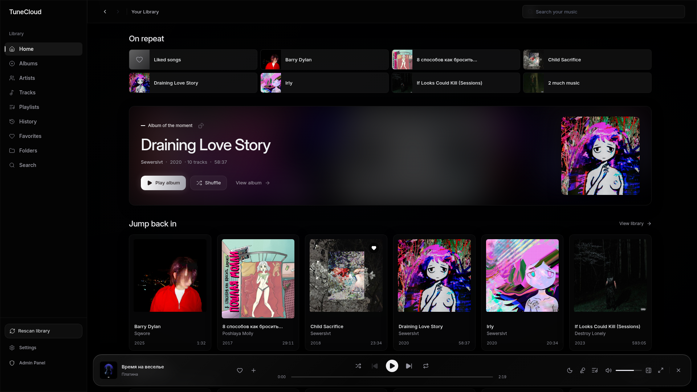</a>
      <p><strong>Floating player</strong><br />Playback, seeking, lyrics, and queue controls stay within reach.</p>
    </td>
    <td width="50%">
      <a href="pictures/05_album_detail.png">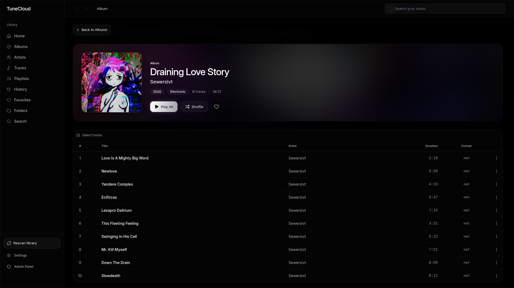</a>
      <p><strong>Album view</strong><br />Artwork, credits, track order, and audio format in one place.</p>
    </td>
  </tr>
  <tr>
    <td width="50%">
      <a href="pictures/03_albums_toolbar.png">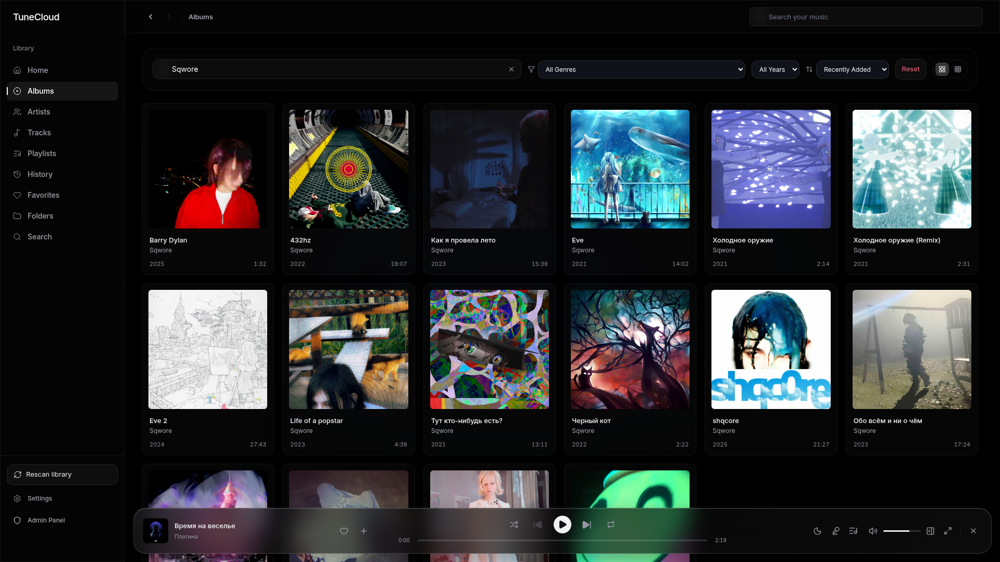</a>
      <p><strong>Album library</strong><br />Search, filter, and sort across the collection.</p>
    </td>
    <td width="50%">
      <a href="pictures/04_compact_grid.png">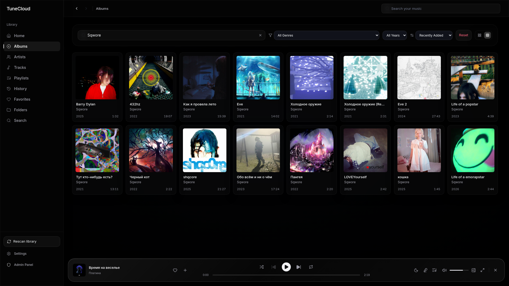</a>
      <p><strong>Compact layout</strong><br />A denser grid for browsing larger libraries.</p>
    </td>
  </tr>
  <tr>
    <td width="50%">
      <a href="pictures/08_now_playing.png">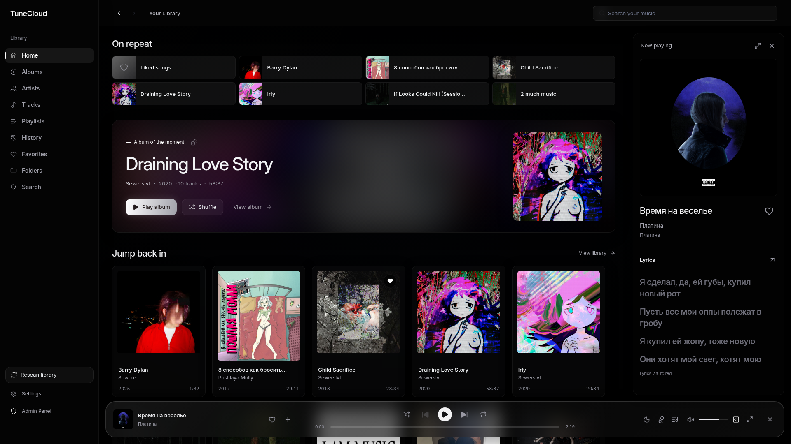</a>
      <p><strong>Now playing</strong><br />Artwork and track details, expandable lyrics, and quick access to the queue.</p>
    </td>
    <td width="50%">
      <a href="pictures/09_queue.png">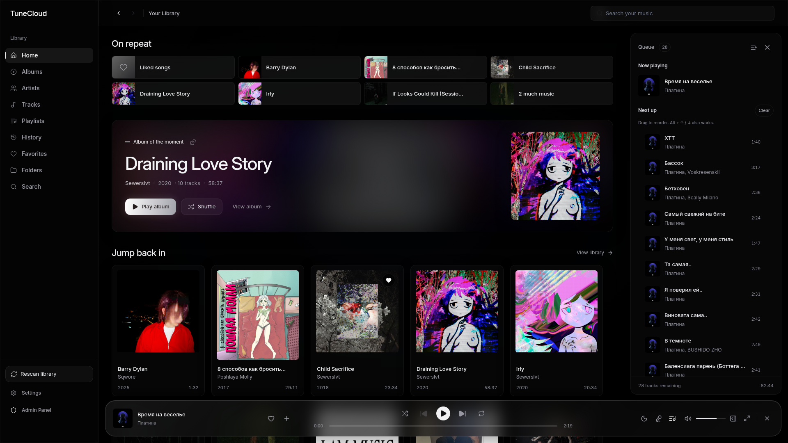</a>
      <p><strong>Playback queue</strong><br />Upcoming songs, reordering, and saving the queue as a playlist.</p>
    </td>
  </tr>
</table>

<details>
<summary>Lyrics and mobile views</summary>

<p><strong>Line-synchronized lyrics</strong> — a wider lyrics column, artwork colors, and the source in the corner. Playback controls appear over the cover on hover.</p>
<a href="pictures/06_karaoke_lyrics.png">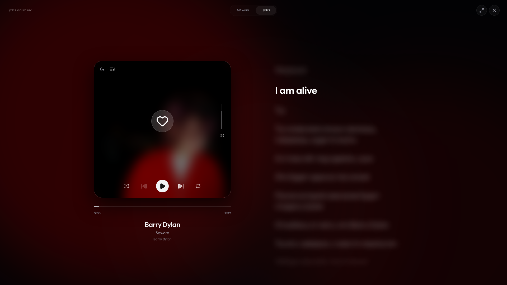</a>

<p><strong>Mobile home and player</strong> — compact album spotlight and a full player with large artwork.</p>
<a href="pictures/07_mobile.png">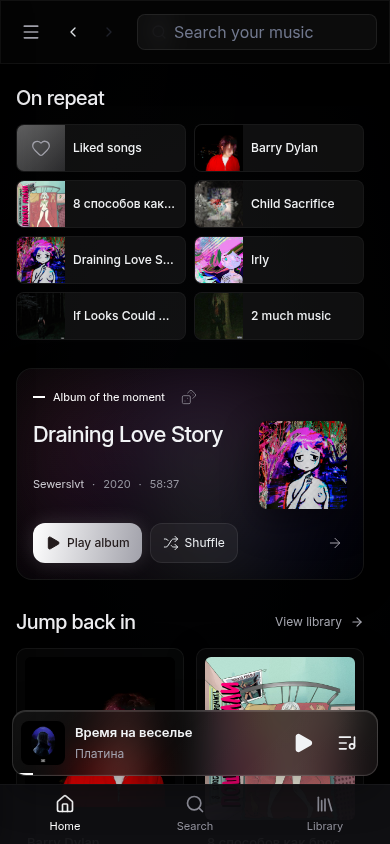</a>
<a href="pictures/10_mobile_now_playing.png">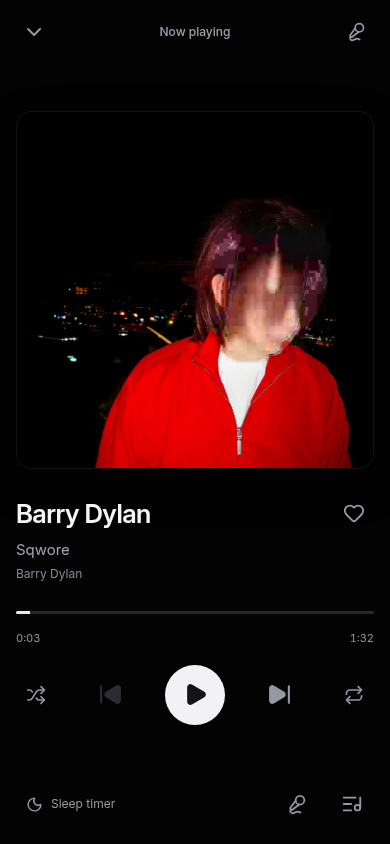</a>

</details>

<details>
<summary>Interface demos · 1920 × 1080</summary>

**Home and playback queue** — opening the queue wraps album cards into fewer columns while preserving their size.

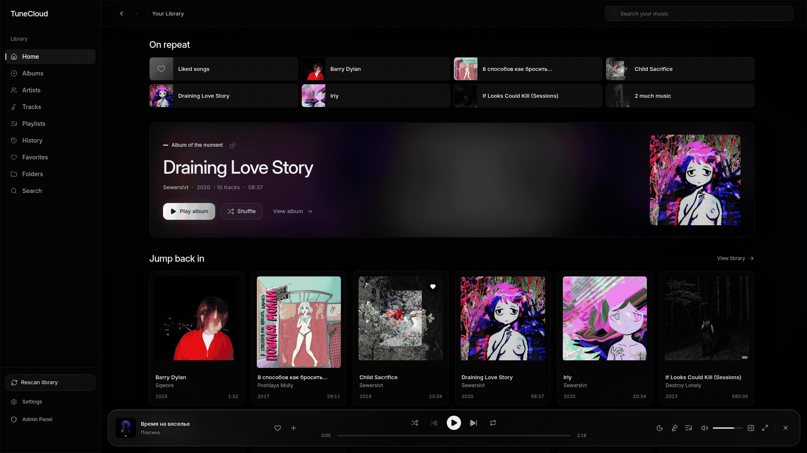

[MP4](pictures/home_demo.mp4) · [WebM](pictures/home_demo.webm)

**Synchronized lyrics** — «Выдох», with smooth line highlighting and scrolling alongside the artwork and its background colors.

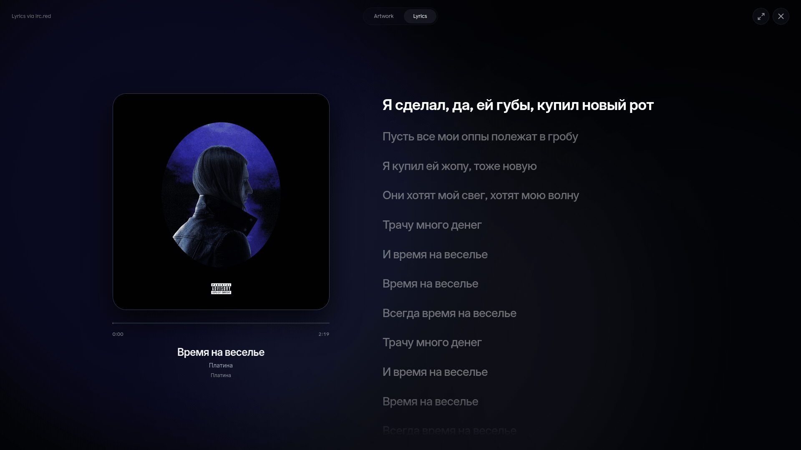

[MP4](pictures/lyrics_demo.mp4) · [WebM](pictures/lyrics_demo.webm)

</details>

## Install as an app

TuneCloud can be installed as a PWA on supported browsers. Open your instance over HTTPS (or localhost), then use **Settings → TuneCloud App → Install TuneCloud** when the install button is available, or your browser’s installation menu. On iPhone and iPad, use Safari’s **Share → Add to Home Screen**.

The installed app opens in its own window and uses the same account and server. Only the public interface assets are cached; audio, artwork from the API, authentication responses, and library data are not saved by the service worker. An offline launch displays a reconnect screen; offline music playback is not supported.

Updates wait until all TuneCloud windows and tabs close, so an update does not restart a playing session. You can check for updates in Settings. The service worker is generated only for production builds; the Vite development server does not register it.

## DevOps focus

TuneCloud is primarily a DevOps portfolio project, with a working music server as the application behind it. The focus is on the full delivery and operations lifecycle: container builds, automated checks, image publishing, GitOps deployments to Kubernetes, persistent storage, health checks, and monitoring with Prometheus and Grafana. Application code lives here; Helm charts and deployment configuration are maintained in the separate [TuneCloud-GitOps repository](https://github.com/skippingclass/TuneCloud-GitOps).

## Quickstart

Requires Docker Compose and a folder containing your music.

```bash
git clone https://github.com/skippingclass/TuneCloud.git
cd TuneCloud
cp .env.example .env
```

Edit `.env` before starting:

| Variable | Set it to |
| --- | --- |
| `MUSIC_DIR` | Absolute path to your music folder |
| `POSTGRES_PASSWORD` | A unique database password |
| `JWT_SECRET` | A random secret of at least 32 characters; generate one with `openssl rand -hex 32` |
| `ADMIN_PASSWORD` | A unique initial administrator password of at least 12 UTF-8 bytes, at most 72 |
| `APP_PORT` | The public HTTP port; defaults to `80` |
| `COOKIE_SECURE` | `true` when served over HTTPS; `false` for a local HTTP installation |

```bash
docker compose up -d
```

Open `http://YOUR_SERVER:APP_PORT`. Sign in with `ADMIN_USERNAME` (default `admin`) and the `ADMIN_PASSWORD` you configured, then start a library scan. There is no default administrator password.

The web player, REST API, and Subsonic API share the same public port. For a Subsonic client, use the same server URL and account credentials. Client support varies by app and endpoint.

To build the images from this checkout instead of using the published images:

```bash
docker compose up -d --build
```

### Storage and configuration

Music is mounted read-only by default. PostgreSQL data and cached artwork use the `pgdata` and `covers_data` volumes. Back up the database and music collection before moving an installation.

To enable tag editing for MP3, FLAC, Ogg, Opus, M4A, WAV, WMA, and AAC, set both `TAG_EDITING_ENABLED=true` and `MUSIC_MOUNT_MODE=rw`. For Kubernetes, set `TAG_EDITING_ENABLED: "true"` on the server container and mount the music volume with `readOnly: false`. The server runs as UID/GID 1000; the directory and files must permit writes for that identity, including creating and renaming temporary files in each music directory. `MUSIC_MOUNT_MODE` is a Docker Compose setting and has no effect in Kubernetes. Spotify artist lookup is optional; configure `SPOTIFY_CLIENT_ID` and `SPOTIFY_CLIENT_SECRET` to enable it.

Web lyrics prefer an existing synchronized cache entry, then local and embedded synchronized text, lrc.red, and LRCLIB. Plain text is the fallback. Set `LRC_RED_CONTACT_EMAIL` to the contact email of the person running your server; it is sent to lrc.red in the server's User-Agent. There is no built-in contact address: when the variable is empty or invalid, new requests skip lrc.red and continue to LRCLIB. Cached lyrics remain available, and lrc.red data is credited in the player. Set a stable `SUBSONIC_ENCRYPTION_KEY` before rotating `JWT_SECRET` to preserve encrypted Subsonic credentials. See [.env.example](.env.example) for the complete configuration.

## Architecture

The browser connects to Nginx, which serves the React app and proxies `/api/` and `/rest/` to Fastify. The server reads the music library, stores metadata and user data in PostgreSQL, and caches artwork on disk.

| Layer | Technologies |
| --- | --- |
| Web interface | React 18, Vite 7, Tailwind CSS 4, Lucide |
| API and storage | Node.js 22+, Fastify 5, PostgreSQL 16 |
| Media integrations | Subsonic / OpenSubsonic, lrc.red, LRCLIB, Spotify / Deezer |
| Containers and deployment | Docker Compose, Nginx, Kubernetes (k3s), Helm, Argo CD |
| Delivery and monitoring | GitHub Actions, GHCR, Prometheus, Grafana |

[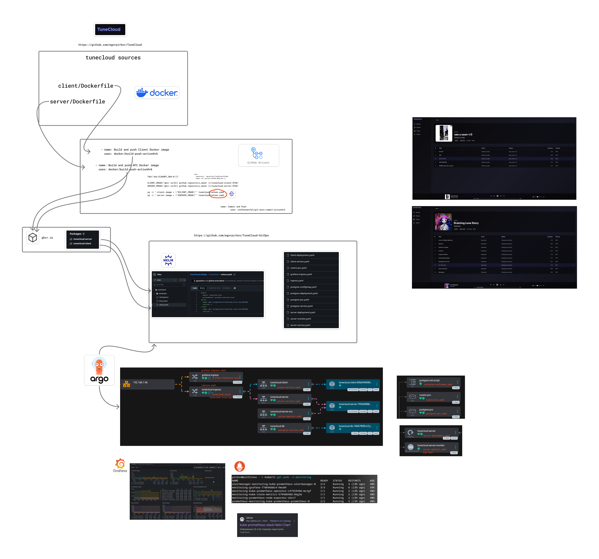](pictures/full.png)

<details>
<summary>Individual architecture diagrams</summary>

**Continuous integration**

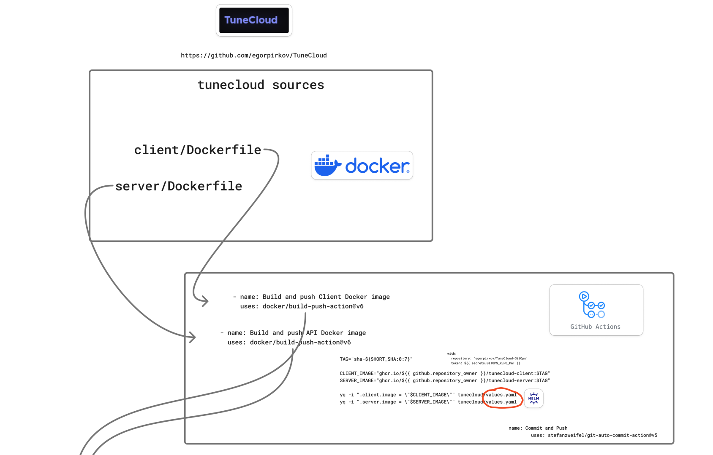

**GitOps delivery**

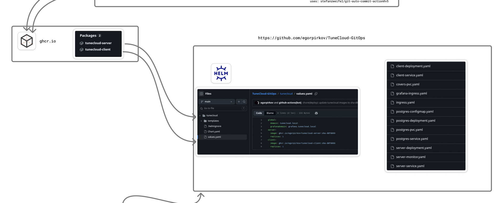

**Monitoring**

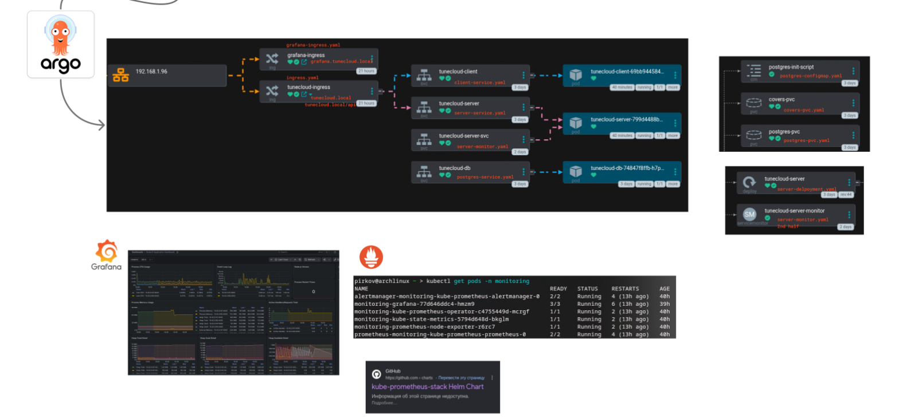

</details>

### Delivery and operations

Pull requests and pushes to `main` run syntax checks, server tests against PostgreSQL, client tests, and a production frontend build. Successful pushes build and publish client and server images to GHCR using `latest` and short-SHA tags. A follow-up job updates the image references in the GitOps repository; Argo CD applies those changes to the cluster.

Helm charts and Kubernetes configuration live in [TuneCloud-GitOps](https://github.com/skippingclass/TuneCloud-GitOps). Keep deployment secrets in the target environment. For a manual Helm installation:

```bash
git clone https://github.com/skippingclass/TuneCloud-GitOps.git
helm install tunecloud ./TuneCloud-GitOps/tunecloud \
  --namespace tunecloud --create-namespace
```

The API exposes `/api/health` for liveness, `/api/ready` for database readiness, and `/metrics` for Prometheus. Metrics include library size, scan results, and active audio streams. The GitOps setup integrates Prometheus and Grafana.

## Development

Use Node.js 22.15+ and PostgreSQL. Configure `server/.env` from [server/.env.example](server/.env.example) with a local database and music directory.

```bash
npm ci
npm ci --prefix server
npm ci --prefix client
npm run db:migrate
npm run dev
```

Vite serves the frontend on port `5173` and proxies API requests to the server on port `4000`.

```bash
npm run check --prefix server
npm test
npm run build
```

Database integration tests require `TEST_DATABASE_URL` pointing to a separate test database. Alternatively, with PostgreSQL tools installed, run `bash server/scripts/test-postgres.sh` to create a disposable cluster. Integration suites are skipped when `TEST_DATABASE_URL` is absent from a normal `npm test` run.

### Refreshing screenshots

The capture script uses headless Chromium against a running instance and defaults to the Midnight theme. It captures the home, player, album library, album detail, lyrics, desktop side panels, and mobile layouts. Credentials are read from `TUNECLOUD_USERNAME` and `TUNECLOUD_PASSWORD`; they are never written to the script, screenshots, or browser state files. See [scripts/capture-readme.mjs](scripts/capture-readme.mjs) for setup and capture options.

Set `CAPTURE_DEMOS=1` to also refresh the 1080p GIF, MP4, and WebM demos. This option requires `ffmpeg`.
Use `CAPTURE_ONLY_DEMOS=1` to update the animations without changing the screenshots. Use `CAPTURE_ONLY_LYRICS=1` to refresh only the lyrics demo with natural animation, and `CAPTURE_LYRICS_START` to choose its starting time in seconds (default: 16). The default demo track is «Выдох»; use `CAPTURE_LYRICS_QUERY` and `CAPTURE_LYRICS_ARTIST` to select a different track.

## Credits and license

Project author contact: [itzmeowzer@gmail.com](mailto:itzmeowzer@gmail.com). This is the author's contact, not a default identity for servers running TuneCloud.

Design process adapted from [unslop by Damir Sokolovsky (@heydamir)](https://github.com/heydamir/unslop), licensed under CC BY 4.0. Album artwork and lyrics belong to their respective rights holders.

TuneCloud is licensed under [GPL v3.0](LICENSE).

### OpenSubsonic compatibility and metadata upgrades

Library synchronization supports empty `search3` queries and stable paging, including pages larger than 100 entries. Search counts must be integers from 0 to 10000. Cover requests accept sizes from 1 to 2048 pixels. Subsonic sync and artwork delivery are independent of the web request quota; failed account logins remain throttled.

Migration 012 preserves existing IDs and user data while adding structured metadata and edition identities. The next library scan reads existing file tags once to populate artist credits, separate genres, compilation flags, disc totals and MusicBrainz IDs. Releases in different album folders are kept separate unless they share an explicit MusicBrainz release ID. Already merged editions are separated during scanning; the retained album ID keeps its existing favorites and ratings.

When an HTTPS ingress or a URL prefix hides the public origin from the backend, set `PUBLIC_URL` to the externally accessible base URL (for example, `https://music.example.com`). OpenSubsonic image links use that base URL. Otherwise they use the request origin, respecting the configured trusted proxies.
