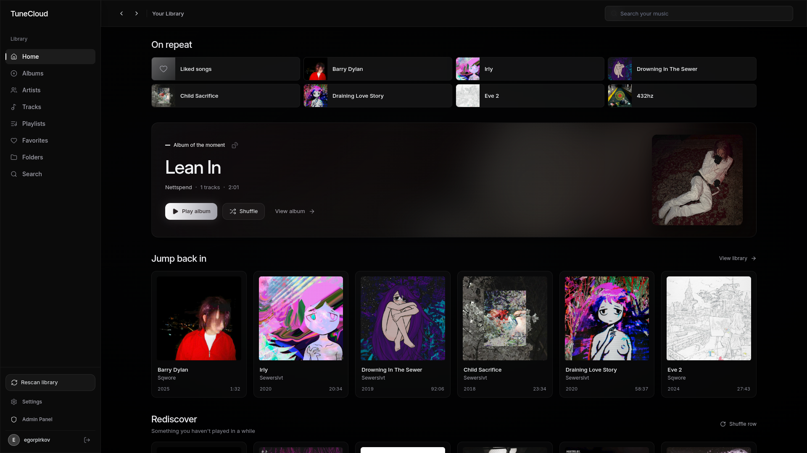
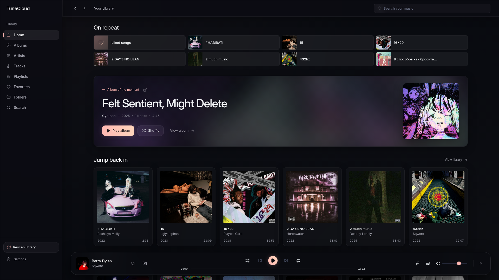
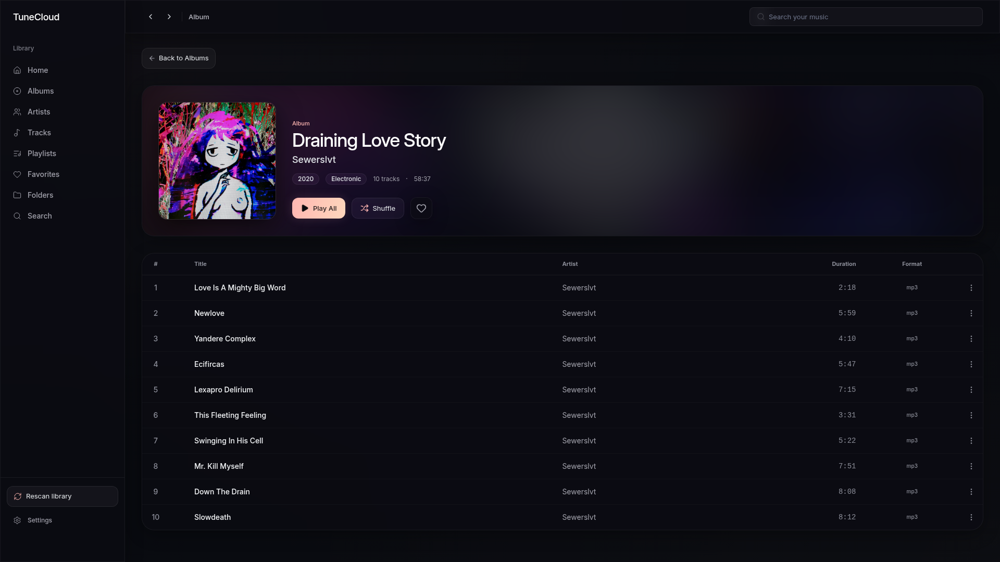
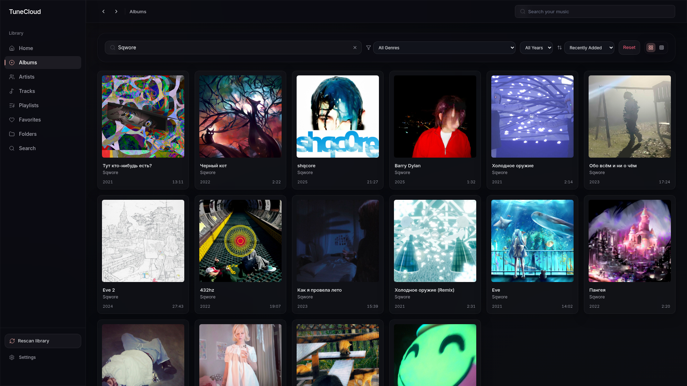
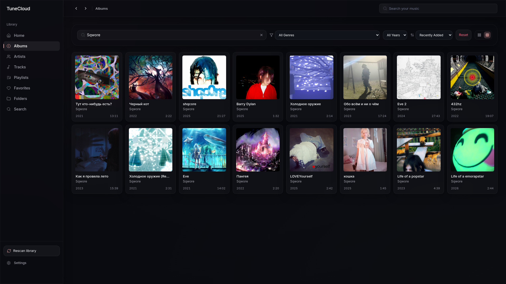
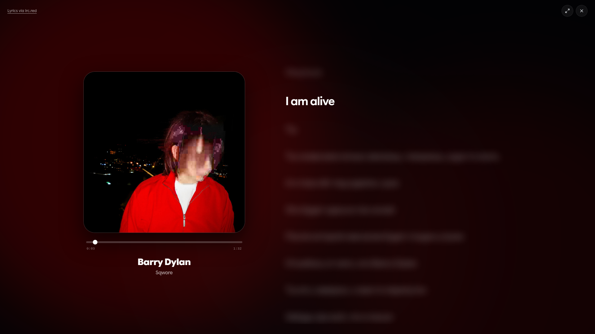
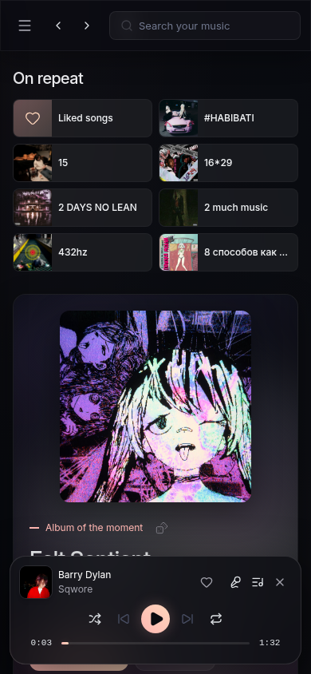

# TuneCloud

A self-hosted music server with a React web player, a Subsonic-compatible API, and a Docker-to-Kubernetes delivery pipeline.

[Production instance](https://tune.realgeek.ru/) · [Quickstart](#quickstart) · [Development](#development) · [GitOps repository](https://github.com/skippingclass/TuneCloud-GitOps)



## Features

- **Your music, on your server.** Scan local folders, browse albums and artists, search the collection, and manage playlists and favorites.
- **A web player built for listening.** A floating player, playback queue, cover viewer, and responsive layouts. The Mix design combines peach accents and glass surfaces with consistent spacing.
- **Line-synchronized lyrics.** Highlighting, automatic scrolling, and click-to-seek from local files, embedded tags, [lrc.red](https://lrc.red), and [LRCLIB](https://lrclib.net). Word timestamps are reduced to line timing.
- **Subsonic clients.** Native audio streaming with HTTP range requests, search, playlists, favorites, ratings, scrobbling, and saved queues. Streaming serves the original audio; server-side transcoding is not implemented.
- **Incremental library scans.** Re-read changed files or run a full metadata scan. Missing files retain their IDs and playlist, favorite, and history references.
- **Multiple users.** Administrator-managed accounts, personal listening history, session revocation, and optional MP3 tag editing.

## Screenshots

The Mix interface with the music library from the [production instance](https://tune.realgeek.ru/). Select an image to open it at full resolution.

<table>
  <tr>
    <td width="50%">
      <a href="pictures/02_floating_player.png"></a>
      <p><strong>Floating player</strong><br />Playback, seeking, lyrics, and queue controls stay within reach.</p>
    </td>
    <td width="50%">
      <a href="pictures/05_album_detail.png"></a>
      <p><strong>Album view</strong><br />Artwork, credits, track order, and audio format in one place.</p>
    </td>
  </tr>
  <tr>
    <td width="50%">
      <a href="pictures/03_albums_toolbar.png"></a>
      <p><strong>Album library</strong><br />Search, filter, and sort across the collection.</p>
    </td>
    <td width="50%">
      <a href="pictures/04_compact_grid.png"></a>
      <p><strong>Compact layout</strong><br />A denser grid for browsing larger libraries.</p>
    </td>
  </tr>
</table>

<details>
<summary>Lyrics and mobile views</summary>

<p><strong>Line-synchronized lyrics</strong> — surrounding text is blurred in this capture to keep the focus on the active line.</p>
<a href="pictures/06_karaoke_lyrics.png"></a>

<p><strong>Mobile player</strong></p>
<a href="pictures/07_mobile.png"></a>

</details>

## DevOps focus

TuneCloud is primarily a DevOps portfolio project, with a working music server as the application behind it. The focus is on the full delivery and operations lifecycle: container builds, automated checks, image publishing, GitOps deployments to Kubernetes, persistent storage, health checks, and monitoring with Prometheus and Grafana. Application code lives here; Helm charts and deployment configuration are maintained in the separate [TuneCloud-GitOps repository](https://github.com/skippingclass/TuneCloud-GitOps).

## Quickstart

Requires Docker Compose and a folder containing your music.

```bash
git clone https://github.com/skippingclass/TuneCloud.git
cd TuneCloud
cp .env.example .env
```

Edit `.env` before starting:

| Variable | Set it to |
| --- | --- |
| `MUSIC_DIR` | Absolute path to your music folder |
| `POSTGRES_PASSWORD` | A unique database password |
| `JWT_SECRET` | A random secret of at least 32 characters; generate one with `openssl rand -hex 32` |
| `ADMIN_PASSWORD` | A unique initial administrator password of at least 12 UTF-8 bytes, at most 72 |
| `APP_PORT` | The public HTTP port; defaults to `80` |
| `COOKIE_SECURE` | `true` when served over HTTPS; `false` for a local HTTP installation |

```bash
docker compose up -d
```

Open `http://YOUR_SERVER:APP_PORT`. Sign in with `ADMIN_USERNAME` (default `admin`) and the `ADMIN_PASSWORD` you configured, then start a library scan. There is no default administrator password.

The web player, REST API, and Subsonic API share the same public port. For a Subsonic client, use the same server URL and account credentials. Client support varies by app and endpoint.

To build the images from this checkout instead of using the published images:

```bash
docker compose up -d --build
```

### Storage and configuration

Music is mounted read-only by default. PostgreSQL data and cached artwork use the `pgdata` and `covers_data` volumes. Back up the database and music collection before moving an installation.

To enable MP3 tag editing, set both `TAG_EDITING_ENABLED=true` and `MUSIC_MOUNT_MODE=rw`. Spotify artist lookup is optional; configure `SPOTIFY_CLIENT_ID` and `SPOTIFY_CLIENT_SECRET` to enable it.

Web lyrics prefer an existing synchronized cache entry, then local and embedded synchronized text, lrc.red, and LRCLIB. Plain text is the fallback. `LRC_RED_CONTACT_EMAIL` identifies your installation to lrc.red; its data is credited in the player. Set a stable `SUBSONIC_ENCRYPTION_KEY` before rotating `JWT_SECRET` to preserve encrypted Subsonic credentials. See [.env.example](.env.example) for the complete configuration.

## Architecture

The browser connects to Nginx, which serves the React app and proxies `/api/` and `/rest/` to Fastify. The server reads the music library, stores metadata and user data in PostgreSQL, and caches artwork on disk.

| Layer | Technologies |
| --- | --- |
| Web interface | React 18, Vite 7, Tailwind CSS 4, Lucide |
| API and storage | Node.js 22+, Fastify 5, PostgreSQL 16 |
| Media integrations | Subsonic / OpenSubsonic, lrc.red, LRCLIB, Spotify / Deezer |
| Containers and deployment | Docker Compose, Nginx, Kubernetes (k3s), Helm, Argo CD |
| Delivery and monitoring | GitHub Actions, GHCR, Prometheus, Grafana |

[](pictures/full.png)

<details>
<summary>Individual architecture diagrams</summary>

**Continuous integration**


**GitOps delivery**


**Monitoring**


</details>

### Delivery and operations

Pull requests and pushes to `main` run syntax checks, server tests against PostgreSQL, client tests, and a production frontend build. Successful pushes build and publish client and server images to GHCR using `latest` and short-SHA tags. A follow-up job updates the image references in the GitOps repository; Argo CD applies those changes to the cluster.

Helm charts and Kubernetes configuration live in [TuneCloud-GitOps](https://github.com/skippingclass/TuneCloud-GitOps). Keep deployment secrets in the target environment. For a manual Helm installation:

```bash
git clone https://github.com/skippingclass/TuneCloud-GitOps.git
helm install tunecloud ./TuneCloud-GitOps/tunecloud \
  --namespace tunecloud --create-namespace
```

The API exposes `/api/health` for liveness, `/api/ready` for database readiness, and `/metrics` for Prometheus. Metrics include library size, scan results, and active audio streams. The GitOps setup integrates Prometheus and Grafana.

## Development

Use Node.js 22.15+ and PostgreSQL. Configure `server/.env` from [server/.env.example](server/.env.example) with a local database and music directory.

```bash
npm ci
npm ci --prefix server
npm ci --prefix client
npm run db:migrate
npm run dev
```

Vite serves the frontend on port `5173` and proxies API requests to the server on port `4000`.

```bash
npm run check --prefix server
npm test
npm run build
```

Database integration tests require `TEST_DATABASE_URL` pointing to a separate test database. Alternatively, with PostgreSQL tools installed, run `bash server/scripts/test-postgres.sh` to create a disposable cluster. Integration suites are skipped when `TEST_DATABASE_URL` is absent from a normal `npm test` run.

### Refreshing screenshots

The capture script uses headless Chromium against a running instance. Credentials are read from `TUNECLOUD_USERNAME` and `TUNECLOUD_PASSWORD`; they are never written to the script, screenshots, or browser state files. See [scripts/capture-readme.mjs](scripts/capture-readme.mjs) for setup and capture options.

## Credits and license

Design process adapted from [unslop by Damir Sokolovsky (@heydamir)](https://github.com/heydamir/unslop), licensed under CC BY 4.0. Album artwork and lyrics belong to their respective rights holders.

TuneCloud is licensed under [GPL v3.0](LICENSE).
